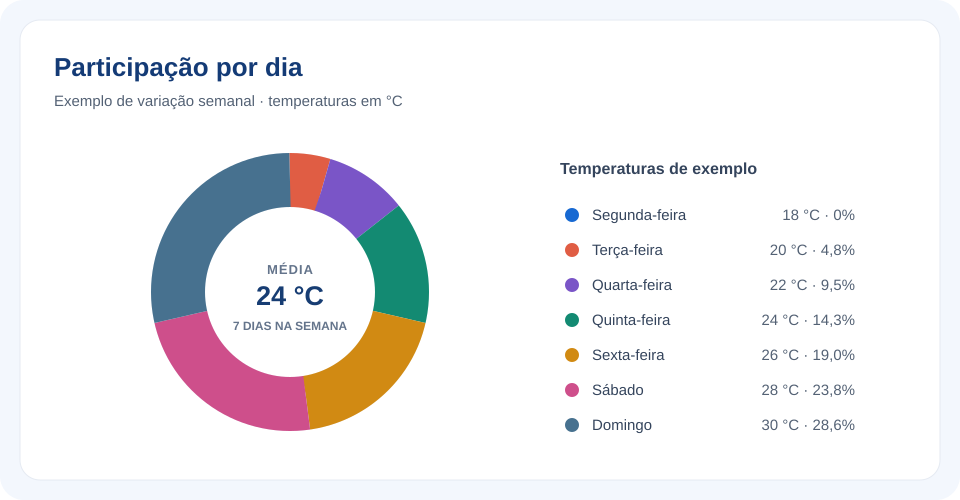

# Atividade de temperatura

Projeto de análise das temperaturas de uma semana, com uma versão em Python e
uma página interativa em HTML.

## Arquivos

- `curso.py` e `curso_py.py`: calculam a média, as temperaturas máxima e mínima,
  os dias acima da média e uma classificação geral da semana.
- `temperatura_semana.html`: página para informar as temperaturas e visualizar
  um resumo e um gráfico interativo.
- `imagens/grafico-exemplo.svg`: imagem vetorial de exemplo, exibida abaixo e
  versionada junto com o projeto.

## Prévia do gráfico

O gráfico abaixo usa temperaturas de exemplo (de 18 °C a 30 °C) para que a
visualização também apareça diretamente nesta página do GitHub:



## Como executar

### Python

É necessário ter o Python instalado. No terminal, dentro desta pasta, execute:

```bash
python curso.py
```

O arquivo `curso_py.py` executa o mesmo exemplo.

### Página interativa

Abra [`temperatura_semana.html`](temperatura_semana.html) em um navegador. Não
é necessário instalar dependências nem iniciar um servidor. O GitHub mostra o
arquivo HTML como código; para usar a página interativa online, publique o
repositório com o GitHub Pages.
